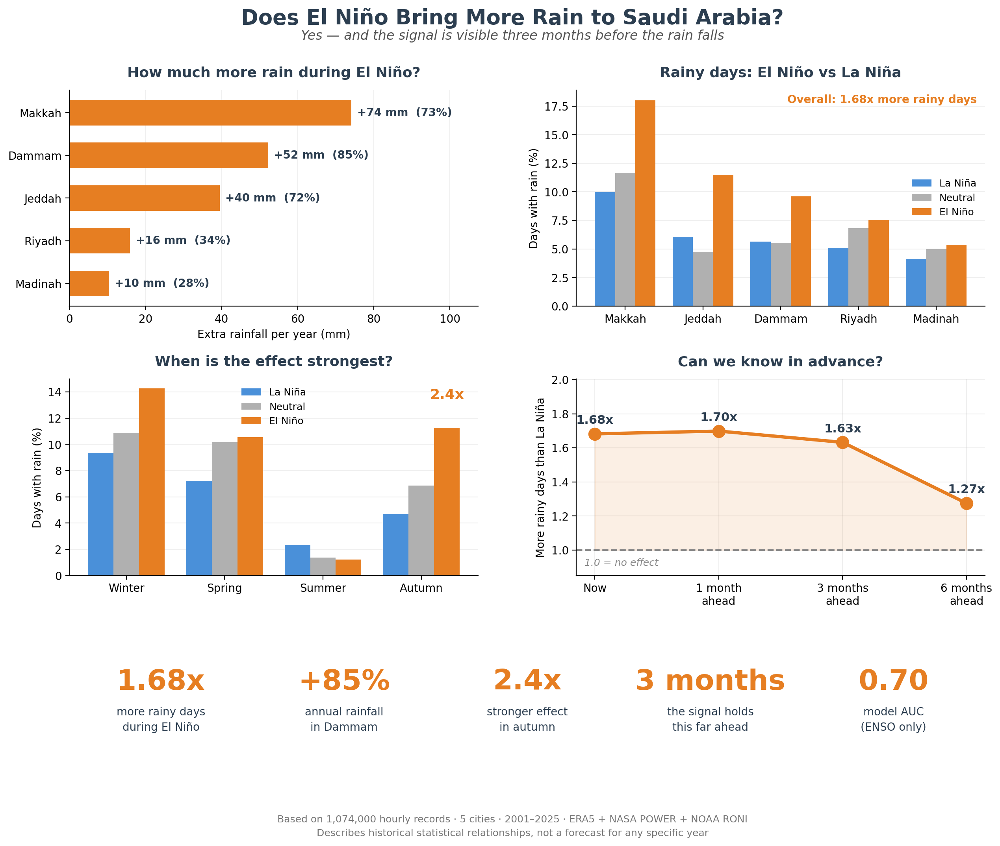

# Does El Niño Reach Saudi Arabia?

A GPU-accelerated machine learning study of whether ENSO (El Niño–Southern Oscillation) carries predictive information for temperature and rainfall in five Saudi cities: Riyadh, Jeddah, Makkah, Madinah and Dammam.



## Key findings

| | Result |
|---|---|
| **Rainfall** | Rain days are **1.68× more frequent** during El Niño (χ² = 145.5, p < 10⁻³³), rising to **2.41× in autumn** |
| **Lead time** | The rainfall signal is still detectable **three months ahead** |
| **Prediction** | A classifier restricted to inputs available in advance reaches **AUC 0.72** |
| **Annual rainfall** | +10 to +74 mm during El Niño, depending on the city ([table](results/table_rainfall_impact.csv)) |
| **Temperature** | **No usable signal.** Four algorithms returned negative R² from ENSO indicators alone (direct correlation −0.029) |

The temperature result is reported on purpose: it is a real negative finding, not a failed experiment.

## Method

- **Data:** about 1.1 million hourly records (2001–2025) from ERA5 and NASA POWER, joined with NOAA's Relative Oceanic Niño Index (RONI). The study starts in 2001 because NASA POWER hourly data does not go further back.
- **GPU pipeline:** loading, cleaning and feature engineering in RAPIDS **cuDF**, models in **cuML** and XGBoost.
- **Validation:** expanding-window **walk-forward splits over 15 years** (315 training runs), so every model is tested only on years it never saw.
- **Leakage control:** three separate forms of target leakage were found and corrected during development. Left in, they would have reported R² = 0.655 instead of 0.200.
- **Explainability:** SHAP, plus a Canonical vs. Modoki El Niño comparison and seasonal stratification.
- **Speed:** cuML trained Random Forest about **25× faster** than scikit-learn on CPU ([benchmark](results/bench_models.csv)).

## Repository

```
notebooks/   enso_saudi_climate_pipeline.ipynb   full pipeline, with outputs
             extra_figures.ipynb                 additional figures for the report
results/     model results per year, rainfall impact tables, GPU benchmarks
data/        nino_indices.csv, roni_data.csv     (small ENSO index files)
reports/     ENSO_Saudi_Report.pdf               full written report
             presentation.html                   presentation deck (open in a browser)
figures/     summary_figure.png
```

## Running it

The notebook runs on a GPU runtime with RAPIDS (for example Google Colab with a GPU).

The merged hourly dataset (`era5_saudi_merged_FINAL.csv`, about 350 MB) is **not included** because of its size. It can be rebuilt from the public sources:

- ERA5 hourly reanalysis (Copernicus Climate Data Store)
- NASA POWER hourly API
- NOAA CPC RONI index (included here as `data/roni_data.csv`)

## Context

Built for the *Scalable Data Science* course of the Tuwaiq Academy AI & Data Science Diploma, 2026.

**Author:** Ritaj Albogami
